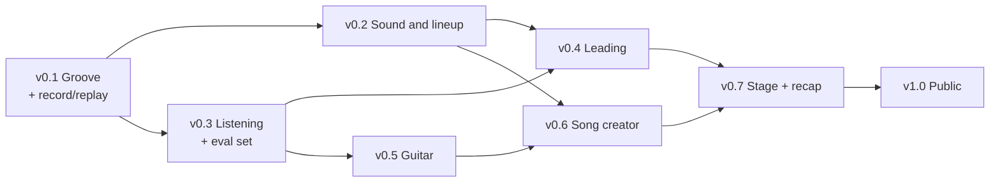

# Roadmap

What comes after v0: seven small releases in three phases, ending in a
public v1.0. Each release has a goal you can hear or see, a scope, and a
"done when" list written like the v0 test plan
([testing/v0.md](testing/v0.md)). A release is finished when Thiago's
hands-on test passes, not when the code merges.

Status: **agreed** with Thiago (2026-10-31). A few smaller open points are
at the end.

## The shape of it

houseband is three things: a **band** that plays, a **bandleader** that
listens and decides, and **your music** (what you play and what you play
over). v0 proved the loop works end to end. The roadmap makes each of the
three good, in that order:

1. **The band sounds like a band** (v0.1–v0.2). Nothing else lands in a demo
   if the band sounds like a sequencer, and everything later is heard
   through it.
2. **The bandleader listens and leads** (v0.3–v0.4). First give it more to
   hear, then make it decide well with that, measured by an eval set.
3. **Your music** (v0.5–v0.7). Play any instrument, bring any song, and play
   it from a real stage view, then go public.

Three things run through every release:
- **The v0 rules hold.** The music never stutters, the browser owns time,
  the Spark is an advisor that can vanish, every move lands on a boundary
  and carries a reason ([architecture.md](architecture.md#design-principles)).
  New inputs (voice, guitar, tempo) are features or moves through the
  governor, never a second clock.
- **Each release ships its own UI.** v0.7 is the polish pass, not the first
  time a feature gets a screen.
- **Genres.** A genre is more than a groove: it decides how the band
  composes, who's in it, how it's produced, and how the leader behaves.
  Every release adds its layer to the same genre packs; see
  [Genres](#genres).

## Genres

A **genre pack** is one data file (plus samples) that every layer reads. It
starts small in v0.1 and each release fills in its part, so by v1.0 a genre
changes everything about how the band plays and sounds.

| Layer | What the genre sets | Added in |
|-------|---------------------|----------|
| Composition | Groove vocabulary per part (drum patterns, bass lines, comping), swing and feel, typical forms and progressions, fills and endings, how intensity levels differ | v0.1 |
| Instrumentation | Default lineup and alternatives (jazz trio vs funk band vs rock four-piece vs bossa duo), which parts exist at all | v0.2 |
| Production | Sounds per part, mix and effects (dry and tight vs roomy, tape saturation, reverb size, drum tuning, sidechain), loudness | v0.2 |
| Listening | What counts as "busy" or "outside" for this genre (a bebop solo vs a blues solo), how strictly to keep tempo | v0.3 |
| Leading | The leader's moves and taste: jazz trades fours and stays dynamic, rock builds to big choruses, a ballad stays out of the way, funk locks the groove and changes little | v0.4 |
| Songs | Text-to-song and free jam know the genre's forms and harmony ("bossa nova in D" gives a bossa form, chords and lineup) | v0.6 |

The pack format is a decision record in v0.1, so genres can be added without
code once the engine supports the layers. The first three genres are
**funk, blues rock and jazz** (Thiago, 2026-10-31): they differ in swing,
harmony, lineup and how a bandleader behaves, so between them they test
every layer. The count stays at those three through v0.5: each release adds its layer to those same genres, and they act as
test cases that keep the engine from assuming one style. The remaining
genres are added in v0.6–v0.7, when the format is stable and a new genre is
mostly data and samples. Target for v1.0: about five genres
that are clearly different (the first three plus, for example, bossa or
Latin and a ballad/soul style), picked with Thiago. Community genre packs after
v1.0.

## Where v0 left us

v0 is done and tested (11 of 12 pass). What it handed over:

- The instruments sound like simple digital synths (test 10, parked).
- The band plays straight and on the grid. Bass is quarter or eighth notes on
  the root, with one approach note into the next chord. Three fixed parts.
- Qwen follows the player only loosely; sparse playing gets mixed moves.
- The leader only sees energy, density, trend and silence. It can't hear
  harmony, phrasing, tempo, or a request from the player.
- Input is MIDI or the computer keyboard only. Charts are typed as JSON.
- Ableton Link ([ADR-0004](decisions/0004-ableton-link-deferred.md)) was
  never tested.

## Releases at a glance

| Phase | Release | Theme | You'll notice |
|-------|---------|-------|---------------|
| Band | **v0.1** | Groove | The band swings, breathes, counts you in and ends songs properly |
| Band | **v0.2** | Sound and lineup | Good built-in instruments, more of them, and you pick who plays on each song |
| Bandleader | **v0.3** | Listening | The band hears your phrasing, harmony and tempo, and takes cues from pedal, pad or voice |
| Bandleader | **v0.4** | Leading | The leader plans the whole song, has a personality, and trades fours with you |
| Your music | **v0.5** | Guitar | Plug in a guitar (or anything with a mic) instead of MIDI |
| Your music | **v0.6** | Song creator | Make a song from a sentence, an editor, a progression you play, or a free jam |
| Your music | **v0.7** | Stage | A UI you'd play from and film, with a recap after each session |
| | **v1.0** | Public | Repo goes public with a demo video |

How they depend on each other:

The key links: session record/replay comes first (v0.1) because every later
release is tested with it; trading fours (v0.4) needs the phrasing signals
(v0.3) and a band instrument to solo on (v0.2); free jam (v0.6) needs pitch
and chords from your input (v0.5); the recap (v0.7) is built on the move log
and the recordings.

## Phase 1: the band sounds like a band

### v0.1: Groove

Status: built (2026-10-31), waiting on the hands-on test in
[testing/v0.1.md](testing/v0.1.md).

**Goal:** the band plays like people, not a sequencer. All engine work, in
`web/src/core`. How the instruments *sound* is v0.2.

Scope:
- **Session recording and replay** (foundation): record the player's input
  (events with beat stamps) and the band's state per bar to a file; replay
  it through the engine and any leader offline. Used from here on to check
  that groove changes don't break anything and, from v0.3, to score the
  leader.
- **Parts as data:** generators keyed by part *role* (drums, bass, keys, and
  room for more) instead of three hard-wired parts, so v0.2 can add
  instruments without touching the arranger.
- **Genre packs, composition layer:** the pack format (decision record) and
  the groove vocabularies for funk, blues rock and jazz. A song picks a genre;
  a section can override feel. Chart format v0.1, superseding
  [ADR-0010](decisions/0010-chart-format-v0.md) additively.
- **Feel in the chart and arranger:** `swing` (0 = straight, 0.66 = triplet
  swing), set by the genre and overridable per section.
- **Humanize:** per-part micro-timing (bass slightly behind, hats ahead or
  behind by style), velocity variation, accents. Seeded, so replays match.
- **Bass lines that move:** a vocabulary per style and intensity: root-fifth,
  octaves, chromatic and scale approaches, walking lines over long chords,
  rests and anticipations, ghost and dead notes at higher intensity, with
  variation so a 16-bar verse doesn't loop one bar.
- **Drums:** ghost notes, open-hat lifts, fills that vary by section and
  intensity, ride vs hat by section.
- **Chords:** comping rhythms per style, voice leading between chords.
- **Intros, endings and count-in:** the band counts you in, plays a pickup or
  intro, and ends on cue (ritardando, final hit, ring-out). New `end_song`
  move, landing on the next phrase.

Done when:
- Through MIDI out to Ableton (so the synth isn't judged), the band sounds
  like players.
- The same chart in two genres sounds like two different bands, through the
  same sounds. Swing at 0 and 0.66 are clearly different; the bass doesn't sound like all
  quarter or all eighth notes over a 16-bar section.
- A song starts with a count-in and an "end the song" cue gives a proper
  ending.
- A recorded session replays to the same band output twice.
- Unit tests pin the generators (seeded) and timing offsets stay inside the
  commit deadline ([ADR-0005](decisions/0005-bar-commit-deadline.md)).
- v0 tests 1–9 still pass.

### v0.2: Sound and lineup

**Goal:** the built-in band sounds good with nothing installed, has more
instruments, and each song says who plays.

Scope:
- **Better built-in instruments (test 10):** sampled instruments (SoundFont/
  SFZ or a small CC0/CC-BY set) with velocity layers, round robins for drums,
  release tails, and a light mix bus (per-part EQ, compression, a shared
  reverb). Loaded lazily from the Spark and cached; the current synth plays
  until samples arrive or if they fail.
- **More instruments:** several sounds per part (bass: electric, upright,
  synth; keys: piano, electric piano, organ; drums: kit, brushes,
  electronic) and new parts with their own generators, built on v0.1's
  groove: rhythm guitar comping, pad/strings, percussion (shaker, congas).
- **Choose who plays on the track:** a `band` (lineup) field in the chart:
  which parts play, with which instrument, at what volume and pan. A lineup
  picker in the page that works live. `add_layer`/`drop_layer` cover every
  part in the lineup, and MIDI out gets one channel per part.
- **Genre packs, instrumentation and production layers:** each genre gets
  a default lineup, its sounds, and a mix preset (effects, room, drum
  tuning, loudness).
- Sample sizes and licenses are written down in `docs/` before a set is
  added.

Done when:
- Thiago's 30-second recording through the built-in sound is something he'd
  post (re-run test 10).
- He can pick upright bass + brushes + piano for one song and electric bass +
  kit + organ + guitar for another, and switch a part's instrument mid-song
  without a click or a dropped bar.
- Switching genre changes the lineup and the mix, and each genre's
  default sounds like that genre.
- The default lineup's samples stay under about 10 MB.

## Phase 2: the bandleader listens and leads

### v0.3: Listening

**Goal:** the leader hears more than loud/soft and busy/sparse, the player
can tell it things directly, and there's a way to measure whether it
decides well.

Scope:
- **More signals to the conductor** (added to the summary in
  [bandleader.md](bandleader.md)):
  - Rhythm: on-beat vs syncopated, the player's swing, pushing or laying
    back against the band's grid.
  - Harmony: how well the player's notes fit the chord and key (inside /
    colour / outside).
  - Phrasing: phrase start/end, call-and-response gaps, held notes, a
    soloist "taking a chorus".
  - Dynamics: crescendo/decrescendo inside a phrase, not just per phrase.
  - Song position: bars to the next section and what it is.
- **The band follows your tempo:** detect rushing or dragging and let the
  band drift with the player within limits, with "strict tempo" as an
  option. A smoothed tempo move, not a new clock.
- **Cues from the player:** sustain pedal, a footswitch or a mapped MIDI CC /
  pad ("next section", "break", "build", "end the song") and keyboard
  shortcuts. Cues go through the governor with priority over the LLM.
- **Voice cues:** say "take it down" or "one more chorus"; Whisper on the
  Spark turns it into the same cue moves. Advisory like any leader output.
- **Leader eval set on the Spark:** recorded and scripted situations ("goes
  sparse for 8 bars", "builds to the chorus", "stops", "calls and waits"),
  each with the moves a good bandleader would or wouldn't make. Features
  are read against the genre (what's "busy" in a ballad isn't in bebop). Scores Qwen
  and the rule leader, run next to `spark/bench_leader.py`. This release
  gets the baseline score; v0.4 improves it.
- **Fretboard view:** a guitar neck (and a keyboard view for keys players)
  showing the scale for the current chord with chord tones highlighted, and
  the next chord's tones coming up before the change. The scale choice comes
  from the genre (blues scale and minor pentatonic for blues rock, dorian
  and mixolydian for funk, chord-scale and bebop scales for jazz). What you
  play on MIDI shows on it live, coloured by how it fits (chord tone, scale
  tone, outside), using the same harmony signal the leader gets.

Done when:
- Hands-on: a call-and-response and a build into a chorus get followed;
  slowing down a little brings the band along; a pad cue and a spoken "one
  more chorus" both land on the next phrase.
- The eval set runs on the Spark and reports a score for both leaders.
- The fretboard shows the right scale and chord tones for each chord in the
  three genres, and changes on the beat of the chord change.
- p95 latency stays inside
  [ADR-0006](decisions/0006-bandleader-latency-contract.md) with the bigger
  summary.

### v0.4: Leading

**Goal:** the leader makes good, varied decisions across a whole song, not
just phrase by phrase. This is where the Qwen tuning lands.

Scope:
- **Prompt and policy tuning for Qwen** against the v0.3 eval set, starting
  with sparse playing (the v0 weak spot).
- **Song-level arc:** the leader gets a short memory of the song so far (what
  each section did, where the peak was) and plans the next sections, so
  chorus 2 isn't a copy of chorus 1. The Spark stays stateless: the page
  sends the arc with each request.
- **Bandleader personality:** presets (steady, supportive, adventurous) that
  set how often and how boldly it moves, through the prompt and the
  governor's dwell times.
- **Genre taste:** the genre pack's leading layer: which moves the leader
  favours, how often it moves, and how it shapes a song (jazz stays
  dynamic and trades, rock builds to the chorus, funk locks in). Personality
  adjusts within the genre's range.
- **Trading fours:** when you lay out at a phrase boundary, a band
  instrument from the lineup takes a short solo or answers your last phrase,
  then hands back when you come in. Uses v0.3's phrasing signals and a
  simple solo generator.

Done when:
- Qwen beats the rule leader on the eval set, and its sparse-playing score
  clears a bar Thiago agrees on.
- Over a full song, the second chorus differs from the first in a way that
  makes sense.
- Two runs with different personalities differ clearly in how much the band
  moves.
- Thiago trades fours with the band for a full chorus.
- Over the same playing, the leader makes recognisably different calls in
  two genres.

## Phase 3: your music

### v0.5: Guitar

**Goal:** play a guitar (or voice, sax, anything with a mic or audio
interface) and the band follows, with no MIDI pickup.

The leader works on per-bar features, not single notes, so audio input
doesn't need low-latency pitch tracking to be useful. Build it in layers,
each usable on its own, all feeding the v0.3 signals:

1. **Audio in + energy/density:** `getUserMedia` (echo cancellation, noise
   suppression and AGC off), an AudioWorklet doing onset detection and RMS.
   Input-gain calibration screen.
2. **Pitch:** monophonic pitch (YIN or similar) for register, lines, harmony
   fit and phrasing. Single-note guitar, bass, voice, horns.
3. **Chords:** polyphonic transcription for strummed guitar. A small model in
   the browser first (e.g. Basic Pitch on WebGPU/WASM); per-bar features to
   the Spark if it's too heavy.
4. **Bleed:** headphones are the default; gating the band's own output from
   the mic is a stretch goal.

**Fretboard, live:** the notes and chords detected from the guitar show on
the v0.3 fretboard as you play, in a likely position on the neck (picked to
stay near where you've been playing), coloured by fit.

Done when:
- Guitar through an audio interface drives the band like the MIDI keyboard
  does in v0 tests 2, 4 and 5, and the v0.3 hands-on tests pass on guitar.
- Audio sessions record and replay like MIDI ones.
- Single notes and strummed chords show on the fretboard within about a beat
  and in a plausible position.

### v0.6: Song creator

**Goal:** a new song to jam over in a minute or two, without writing JSON.

Scope, in order of value:
- **Song editor in the page:** sections, bars, chords per bar, form, tempo,
  key, feel and swing (v0.1), lineup (v0.2), validated live against
  `schema/chart.schema.json`. Songs saved on the Spark.
- **Text to song:** "slow 12/8 blues in G, two verses and a solo, organ
  trio" → a valid chart via Qwen with schema-constrained output, opened in
  the editor to tweak. Uses the genre packs' forms, progressions and
  lineups.
- **Play-in progression:** play a progression once on keys or guitar and it
  becomes a section.
- **Free jam, no chart:** start playing and the band works out key, tempo
  and a progression from you (v0.5 pitch and chords), locks in, and saves it
  as a song you can edit.
- **Audio to chart on the Spark** (stretch): upload a recording, get tempo,
  key, sections and chords (Demucs, allin1, a chord recogniser). Structure
  only; the recording is never played back. Can slip past v1.0.

Done when:
- Thiago makes a song from a sentence, edits it and jams on it in under two
  minutes.
- A free jam turns into a saved song he can reopen.
- Bad generated charts are caught by the schema with a clear message.

### v0.7: Stage

**Goal:** a UI good enough to play from and to film for the demo.

Scope:
- **Stage view:** big section / chord / next-chord display, bar and beat
  counter, count-in, the form as a timeline with the current position.
- **Fretboard on stage:** the fretboard/keyboard view as a panel in the
  stage view, sized to read from a music stand.
- **Band panel:** the lineup with per-part mute/solo, volume and intensity,
  and the move log with reasons as the "bandleader's thoughts".
- **Setup flow:** inputs (MIDI / audio / keys / mic for voice cues), outputs,
  leader and personality, remembered between sessions.
- **Session recap:** after a jam, the move log as a timeline over the form, a
  short summary from Qwen ("you built through the second chorus, the band
  went to half time when you dropped out"), and export of the band's MIDI
  and a mixdown.
- Works on a tablet on a music stand (layout only; the engine stays in the
  browser that has the audio).

Done when:
- Thiago records the demo video from the stage view without touching JSON or
  DevTools, and the recap from that session reads right.

### v1.0: Public

- Repo goes public (Apache 2.0); README, getting started for laptop-only and
  laptop + Spark, a short architecture tour.
- About five genre packs that each sound and lead differently.
- Demo video.
- Decision records brought up to date (the Proposed ones accepted or
  superseded).

## After v1.0

Longer-term goals, in rough order. Both reuse the v0.x pieces rather than
starting over.

- **Phone app:** the phone listens to you through its mic and plays the band
  out of a Bluetooth or wired speaker. The engine is already browser
  TypeScript, so it starts as an installable web app (PWA) and becomes a
  native wrapper only if needed. Needs: v0.5's audio input, the band and
  leader running fully on the phone (rule leader on device, LLM optional over
  the network), and output-latency compensation, since Bluetooth adds about
  150–250 ms between the band and your ears. The governor's bar/phrase
  landing already tolerates late *decisions*; this is about scheduling the
  *sound* earlier by the measured output latency, and about the mic hearing
  the speaker (bleed gating from v0.5 becomes required, not a stretch).
- **Singing mode:** your voice guides the track. Builds on v0.5's pitch
  tracking (voice is single-note) and v0.3's phrasing: the band follows the
  sung melody's energy and phrasing, finds verse vs chorus from melody
  repetition, and picks or adjusts chords to fit what you sing (an
  extension of free jam from v0.6). Needs a voice-tuned pitch tracker
  (vibrato, slides, breathy onsets) and a "fit chords to melody" step,
  probably on the Spark first.
- **Community genre packs:** the pack format from v0.1, documented for
  others to add genres.

## Later

Not scheduled; each can slot in once its question is answered:

- **Ableton Link** through a small local bridge
  ([ADR-0004](decisions/0004-ableton-link-deferred.md)). Untested, and it
  needs a helper app on the Mac, which may not be allowed on Thiago's work
  laptop. Check that first.
- **Generative mid layer on the Spark:** a symbolic model writing the next
  1–2 bars under the same commit-deadline contract. Follows v0.1's
  rule-based groove once replay and the eval set can tell if it's better.
- **Audio mode with Magenta RealTime**, after the spike in
  [ADR-0009](decisions/0009-magenta-realtime-spike.md). The spike can run on
  the Spark any time.
- Max for Live device; remote mode where only the human parts cross the
  network.
- Dropped for now (2026-10-31): practice mode (loop and slow down a section)
  and using a phone as a cue remote.

## Open questions

1. **Order of phase 1.** Groove before sound is the recommendation: the
   groove work is engine-only and shapes what the new instruments play.
   Sound first would fix test 10 sooner.
2. **Sample set for v0.2:** which one (license and size).
3. **Genres:** the first three are decided (funk, blues rock, jazz); the
   other two for v1.0 are open.
4. **Link:** can a local helper app run on the work Mac at all?
